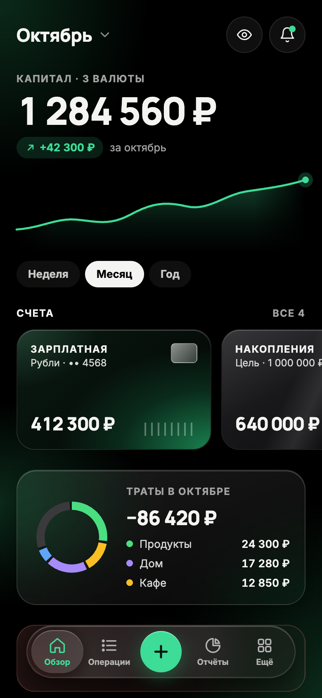
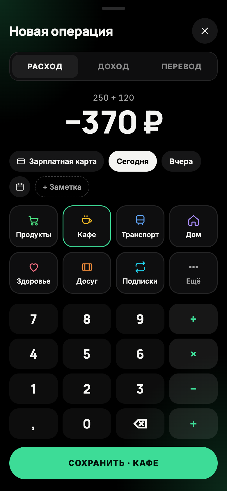
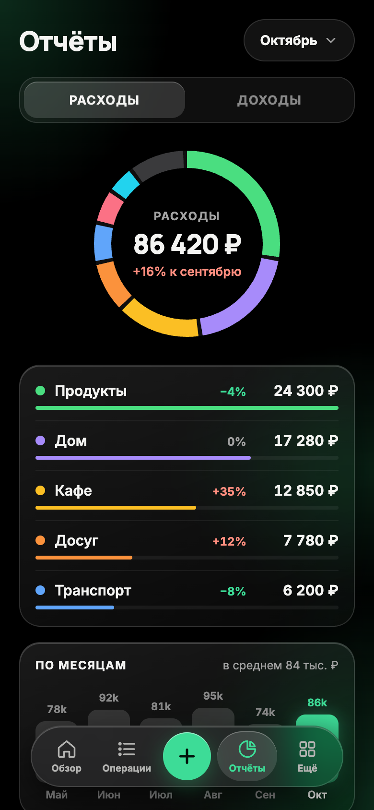

# Birka

Local-first expense tracker for money across currencies, banks and countries.

**Status:** early development. There is nothing to install yet, but the
[site](https://artemchikolaev.github.io/Birka/) already keeps accounts and
categories in your browser. The first milestone is manual tracking with several currencies and
reports.

## Why

Our money lives in several currencies, banks and countries. The trackers we
tried either keep one currency per budget, ask for bank passwords, or keep our
data on their servers. Birka is the tracker we are building for ourselves:
the data stays on the device, every amount keeps its own currency, and reports
convert at the rate of the day. We plan to keep developing it.

The name comes from the *birka* (бирка), an old tally stick on which debts were
recorded with notches, and from Birka, a Viking Age trading town where coins
from many countries changed hands.

## What it will do

- Accounts in any currency: cash, cards, deposits, loans.
- Expenses, income and transfers between currencies at the actual rate.
- Categories, budgets, recurring payments and reports in a base currency.
- Import from bank statements (CSV, OFX) instead of bank passwords.
- Android, iOS and the web from one codebase; the data stays on the device.
- Later: end-to-end encrypted sync through a small self-hosted server.

<p>
  
  
  
</p>

These are mockups of the first version; every screen is in
[docs/design](docs/design/).

## How it is built

- **One pure-Dart core** (money, domain rules, storage, BLoC state) shared by
  two thin hosts: a **Flutter** app for Android and iOS, which also runs on
  macOS during development, and a **Jaspr** web app.
- **Local-first:** SQLite through Drift on every platform, including the web.
- **Exact money:** amounts are integers in minor units, never `double`. Core
  tests run on the Dart VM, dart2js and dart2wasm, so every platform computes
  the same result ([ADR 0003](docs/adr/0003-money-representation.md)).
- **One repository, three zones:** the app, the design system and, later, a Go
  sync relay ([ADR 0001](docs/adr/0001-single-repository.md)).
- **One look on every platform:** colors, glass, type and motion are design
  tokens in the DTCG format, generated into Dart and CSS
  ([ADR 0007](docs/adr/0007-design-tokens.md)).
- **Toolchain:** Flutter 3.38.10 and Dart 3.10.9
  ([ADR 0002](docs/adr/0002-toolchain.md)).

## Repository layout

```text
apps/mobile              Flutter host: Android, iOS, macOS during development
apps/web                 Jaspr host: a static site with interactive islands
packages/core/money      Money and Currency value types
packages/core/database   the one Drift database: its schema and migrations
packages/core/ledger     accounts, categories, transactions and their rules
packages/core/l10n       strings in Russian and English, amounts for people
packages/design/tokens   design tokens and their generator for Dart and CSS
packages/design/flutter  theme, fonts and glass widgets for Flutter
packages/design/jaspr    styles, web fonts and glass components for Jaspr
packages/design/brand    the app icon: a glass coin in SVG and its PNG masters
packages/features        one folder per feature: accounts, categories, overview, transactions
tools                    repository tooling: package boundary checks, dev scripts
docs/adr                 architecture decision records
```

Each feature lives in one folder, `packages/features/<feature>/`, with its
data, domain and presentation layers and a Flutter and a Jaspr UI
([ADR 0006](docs/adr/0006-feature-first-packages.md)).

## Getting started

You need Flutter 3.38.10 (pinned in `.fvmrc`) and GNU Make, and CocoaPods to
build for iOS and macOS.

```bash
make bootstrap                      # fetch dependencies
make check                          # format, analysis, boundaries, tests
make test-core COMPILER=dart2wasm   # core tests in Chrome via WebAssembly
make run-mobile                     # the Flutter app on macOS
make run-web                        # the site on localhost:8080
make build-apk                      # a release APK for Android
make tokens                         # regenerate the design tokens
```

In VS Code, Run and Debug has a configuration for the site, for macOS, the iOS
simulator and the Android emulator, and one that starts all three apps. The iOS
and Android ones start the device if none is running.

## Contributing

Every change, ours included, lands in `main` through a pull request with green
checks, and changes from other contributors also need the maintainer's
approval; repository rulesets enforce both
([ADR 0004](docs/adr/0004-branches-and-releases.md)). Pull requests that
change code also get an advisory review from Claude
([ADR 0005](docs/adr/0005-claude-review.md)). People and coding agents follow
the same rules: [CLAUDE.md](CLAUDE.md).

## License

[MIT](LICENSE). The bundled Inter and Manrope fonts come under the SIL Open
Font License 1.1: see `packages/design/flutter/fonts/`.
