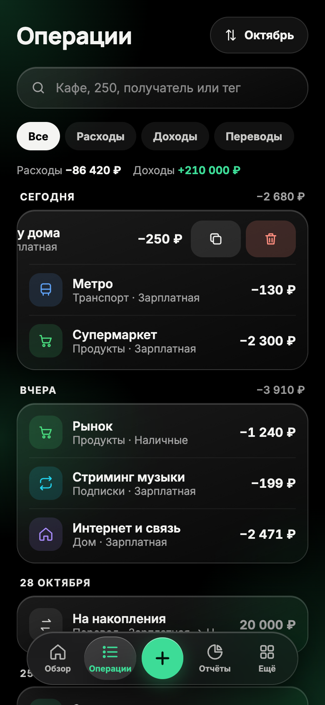
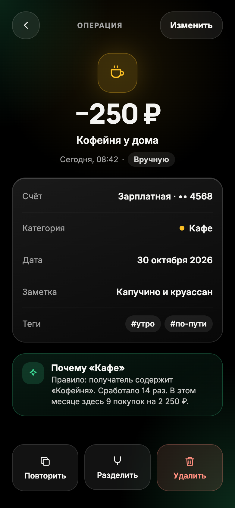
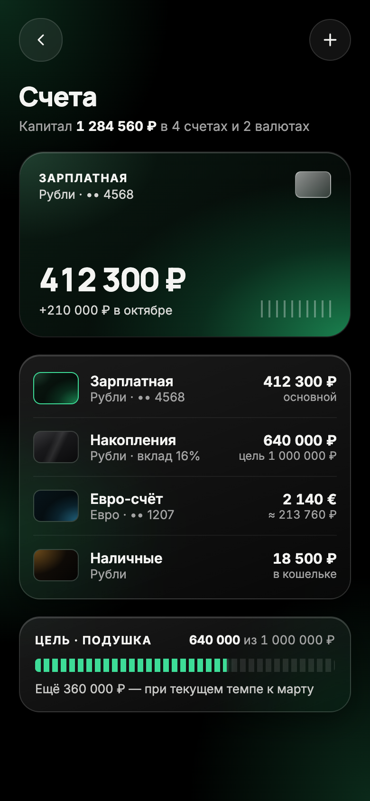
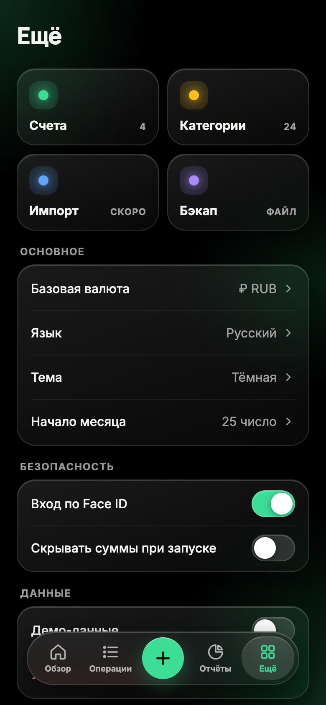
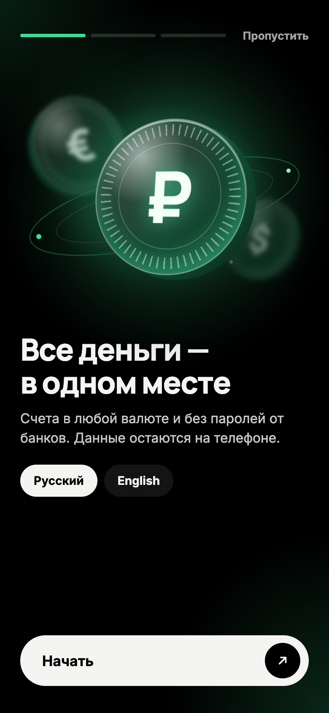
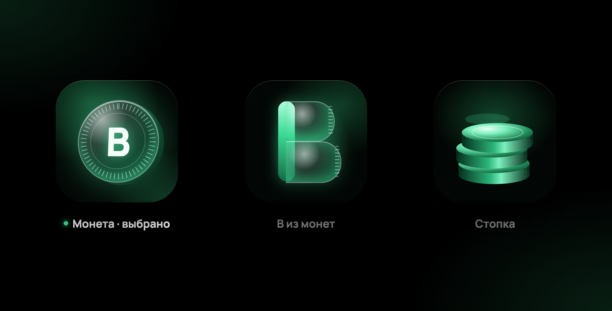
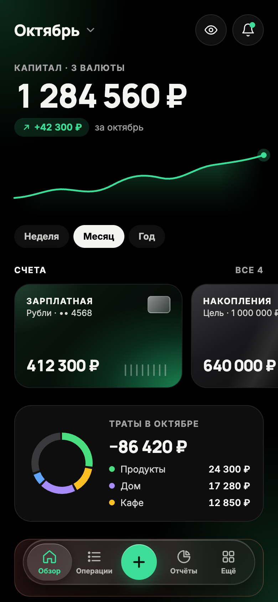

# Design

The mockups of the first version, drawn in October 2026 before the app had
its screens. They set the direction; the exact values live in the design
tokens ([ADR 0007](../adr/0007-design-tokens.md)). When the app and a mockup
disagree, the app and the tokens win, and the mockup gets updated or
retired. Every name and amount in them is made up.

Each screen is a PNG at twice the size of a 390 × 844 phone screen.

## Design language

| Element | In the mockups |
|---|---|
| Base | black; emerald only for accents: the main button, the selected tab, income, progress |
| Surfaces | Liquid Glass: the backdrop blurred with its colors made richer, a faint white gradient fill, a hairline border and a light line along the top edge |
| Glow | a faint emerald glow in the top left and bottom right corners and on the left edge of every screen |
| Type | Manrope ExtraBold for titles and amounts, Inter for the rest; amounts in tabular figures; section labels in spaced capitals |
| Navigation | a floating glass bar centered at the bottom, with a bubble under the selected tab and the add button in the middle |
| Categories | a color each: green, amber, sky, violet, rose, orange, cyan |
| Accounts | cards with abstract art in the color of the account |

## Screens

| Mockup | Screen | What it shows |
|---|---|---|
|  | Overview | the capital across currencies with its change, a chart and a period switch; account cards; spending by category; a button that hides every amount |
|  | Quick add | expense, income or transfer; a keypad that adds up expressions such as 250 + 120; the account, the day and a note; categories in color |
|  | Operations | search by category, amount, payee or tag; filters; totals for the month; operations by day with day totals; a row swiped open to copy or delete |
|  | Transaction | the amount, payee and time; account, category, date, note and tags; the rule that chose the category; repeat, split and delete |
|  | Reports | expenses or income for a month: a ring by category with the change against the month before, each category with its share and change, the last six months as bars |
|  | Accounts | the main account as a card; accounts in rubles and euros with balances in the base currency; a savings goal with its progress |
|  | More | accounts, categories, import and backup; base currency, language, theme and the first day of a month; Face ID and hidden amounts at launch; demo data |
|  | Onboarding | the first of three steps: all money in one place, no bank passwords, the data stays on the phone; the choice of language |
|  | App icon | three options; the chosen one is a glass coin with a milled edge and the letter B |
|  | Overview without glass | the earlier overview with solid cards, kept for comparison |
