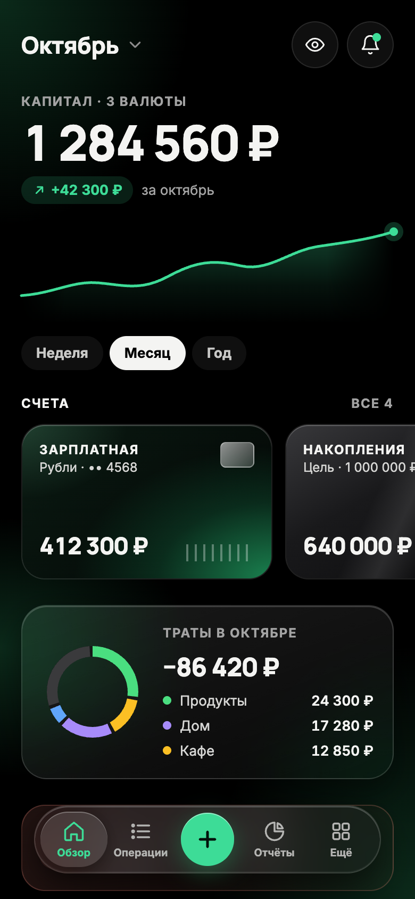
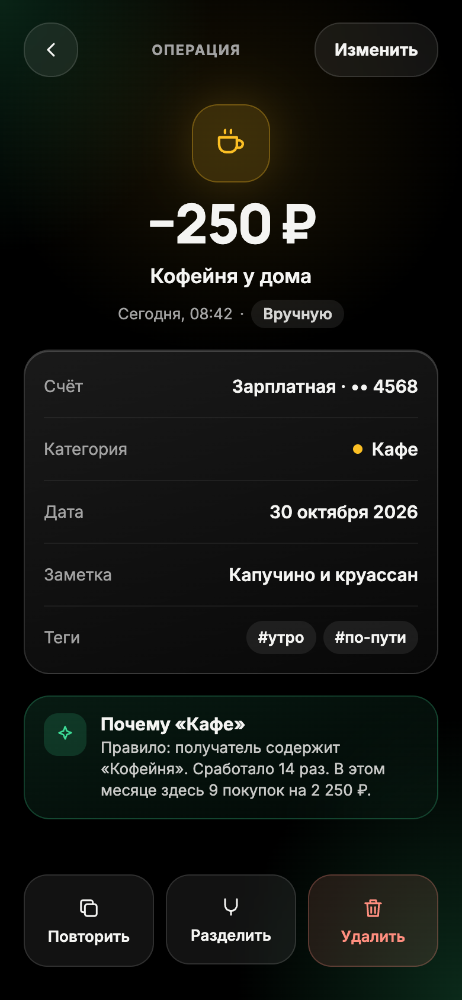
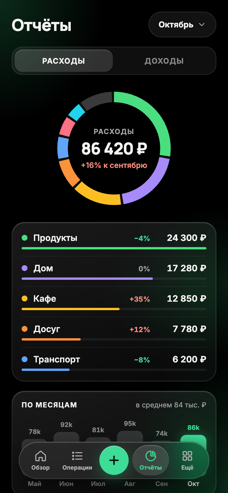
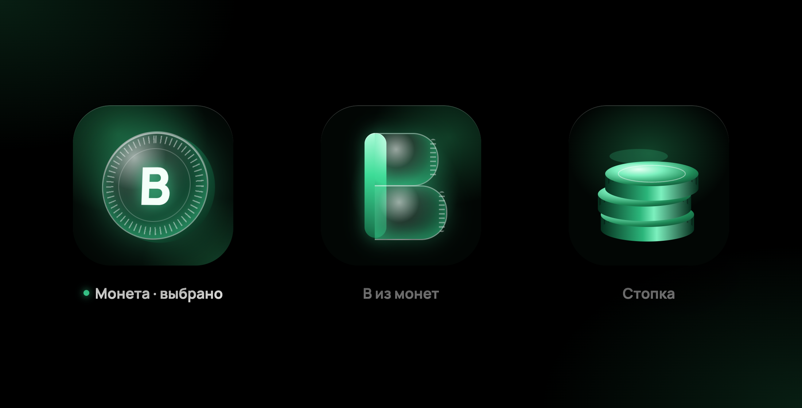
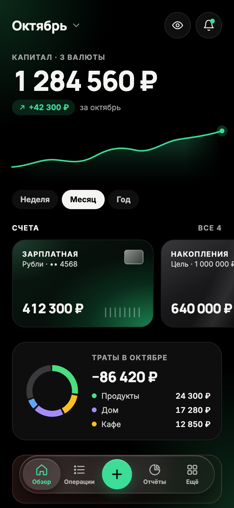
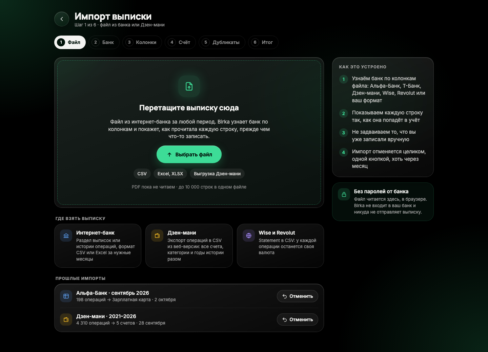
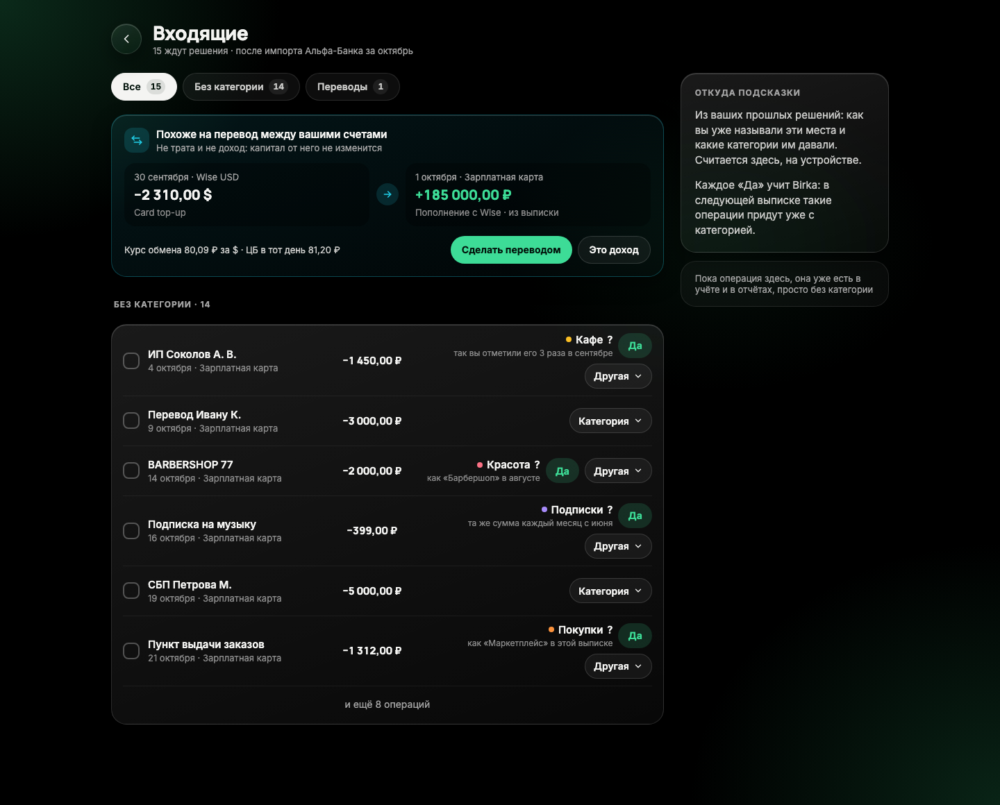
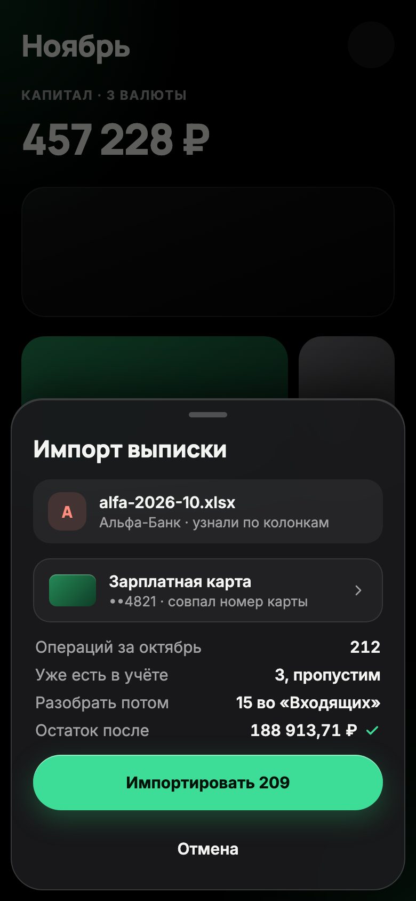

# Design

The mockups of the first version, drawn in October 2026 before the app had
its screens. They set the direction; the exact values live in the design
tokens ([ADR 0007](../adr/0007-design-tokens.md)). When the app and a mockup
disagree, the app and the tokens win, and the mockup gets updated or
retired. Every name and amount in them is made up.

Each screen is a PNG at twice the size of a 390 × 844 phone screen.

## Design system

The design system lives on claude.ai as a Design System artifact:
[Birka](https://claude.ai/artifact/4QTZ9M8s2RqeTRNuNjHLuV). It holds the
tokens, the type with the fonts of the site, the components of the web kit
with live previews and guidelines, the icons, the brand and these mockups.
Its source is [system/](system/), laid out as the artifact's `project/`
folder, so that nothing of the design lives only in an account:

| In `system/` | Comes from |
|---|---|
| `tokens.json` | generated by `make tokens` from the design tokens; `make check-tokens` keeps it in step |
| `README.md` | the brand book, written by hand |
| `components/bundle.css` | the `@css` rules of the web kit, copied by hand |
| `components/<Name>/` | a static preview and the guidelines of each component |
| `design-system.json` | the index of the artifact, with the ids of the uploaded icons, brand art and mockups |

The fonts, icons, brand art and mockups are not copied: they are published
from `packages/design/jaspr/lib/fonts/`, `packages/design/flutter/icons/`,
`packages/design/brand/` and `mockups/`.

## Design canvas

The boards of every feature, for the phone and for the site, are on the
Claude Design canvas
[Birka · Ночь](https://claude.ai/artifact/HWbDNV7NtL5RoBHrLiXqhf). Its source
is [canvas/](canvas/), laid out as the canvas's `project/` folder: the index
`canvas.json` and one `.dc.html` per board. The first canvas lived in an
account that is gone; [canvas/README.md](canvas/README.md) says what was
recovered and what was lost.

Design work done on claude.ai, in Claude Design or in an artifact, comes back
into this folder in the same pull request: new mockups as PNGs into
`mockups/`, changes of the system into `system/`, new and changed boards into
`canvas/`. When a token or a component
of the kit changes, update `system/` and publish it again.

## Design language

| Element | In the mockups |
|---|---|
| Base | black; emerald only for accents: the main button, the selected tab, income, progress |
| Surfaces | Liquid Glass: the backdrop blurred with its colors made richer, a faint white gradient fill, a hairline border and a light line along the top edge |
| Glow | a faint emerald glow in the top left and bottom right corners and on the left edge of every screen |
| Type | Manrope ExtraBold for titles and amounts, Inter for the rest; amounts in tabular figures; section labels in spaced capitals |
| Navigation | a floating glass bar centered at the bottom, with a bubble under the selected tab and the add button in the middle |
| Categories | a color each: green, amber, sky, violet, rose, orange, cyan |
| Accounts | cards with abstract art in the color of the account |

## Screens

| Mockup | Screen | What it shows |
|---|---|---|
|  | Overview | the capital across currencies with its change, a chart and a period switch; account cards; spending by category; a button that hides every amount |
|  | Quick add | expense, income or transfer; a keypad that adds up expressions such as 250 + 120; the account, the day and a note; categories in color |
|  | Operations | search by category, amount, payee or tag; filters; totals for the month; operations by day with day totals; a row swiped open to copy or delete |
|  | Transaction | the amount, payee and time; account, category, date, note and tags; the rule that chose the category; repeat, split and delete |
|  | Reports | expenses or income for a month: a ring by category with the change against the month before, each category with its share and change, the last six months as bars |
|  | Accounts | the main account as a card; accounts in rubles and euros with balances in the base currency; a savings goal with its progress |
|  | More | accounts, categories, import and backup; base currency, language, theme and the first day of a month; Face ID and hidden amounts at launch; demo data |
|  | Onboarding | the first of three steps: all money in one place, no bank passwords, the data stays on the phone; the choice of language |
|  | App icon | three options; the chosen one is a glass coin with a milled edge and the letter B |
|  | Overview without glass | the earlier overview with solid cards, kept for comparison |

## Import of statements

Drawn in November 2026 for the import of statements: a wizard of six steps on
the site and a short way on the phone. The pages of the site are PNGs at their width of
1440 points, and the phone is at twice the size of a 390 × 844 screen. The
banks are the formats that Birka reads; the files, names and amounts are made
up and add up across the pages.

| Mockup | Screen | What it shows |
|---|---|---|
|  | The file | a statement dropped or chosen; where to get one from a bank, Zenmoney, Wise or Revolut; past imports, each with its undo; no bank passwords, the file stays in the browser |
|  | The bank | the format told by its columns, with how many matched; the known formats and a format of one's own; what the file holds |
|  | The columns | what each column holds, with an example; how money spent is signed and what separates kopecks; the dates as read; the first rows as they enter the ledger; the categories of the bank against ours |
|  | The account | the account of the card, found by its digits, or a new one with its balance from the statement; the balance checked against the bank |
|  | Duplicates | operations already recorded by hand, with the reasons they match; skip the copy or keep both; a top-up that looks like a transfer; two purchases of one statement kept |
|  | The result | what was added and skipped, the balance as in the bank, what waits in the inbox; the undo of the whole import |
|  | Inbox | a transfer between one's own accounts to link; operations without a category with hints from past choices; several picked at once |
|  | Import on the phone | a sheet over the overview: the bank and the card told, the counts, the balance after, one button |

### Category history in reports

The [interactive mockup](mockups/report-category-history.html) shows the
category picker inside the six-month chart on phone and desktop. Pick a
category to update the bars and their average. The ring and the category
list still describe the selected month. The chart starts with all categories
and includes categories used earlier in the six-month period.

[Phone preview](mockups/19-category-history-phone.png) ·
[Desktop preview](mockups/20-category-history-web.png)

### Biggest category changes

Below the category list, the monthly report shows up to three increases or
decreases, ranked by the magnitude of the change in the report currency.
The date caption identifies both budget periods. In the current month both
periods end at the same number of elapsed days, capped at the previous
period's end. The amount carries its sign in both expense and income views.

[Phone preview](mockups/21-category-changes-phone.png) ·
[Desktop preview](mockups/22-category-changes-web.png)

### CSV export by date

On Data, export all operations in one tap or select two dates. Both endpoints
are included. The initial range runs from the start of the current budget
month through today. A missing date or reversed range disables the download
and shows how to correct it.

[Interactive mockup](mockups/csv-export-period.html) ·
[Phone preview](mockups/23-csv-period-phone.png) ·
[Desktop preview](mockups/24-csv-period-web.png)

### Operations search across months

Start typing in Operations, then enable All months to include older matches.
The selected transaction type still applies. The totals describe the matches,
and dates from earlier years include the year. Clearing the query or turning
off All months returns to the month being viewed. Search opened from an Ask
answer stays within the answer's operations. Long results open 30 matching
days at a time, keeping every operation of the last visible day together.
The count and amounts cover all matches. In the mockup, search for `обед`
across months to try the longer list.

[Interactive mockup](mockups/operations-history-search.html) ·
[Phone preview](mockups/25-history-search-phone.png) ·
[Desktop preview](mockups/26-history-search-web.png)

### Debts by due date

On the Debts screen, **Due now** includes today and earlier dates.
**In 1–7 days** includes tomorrow through the seventh day. Both show open
balances, grouped by who owes whom. The summary cards show the remaining
amount and number of people on each side for the selected filter. Undated
debts and the settled-debt fold are available under All. If no debt matches,
the list explains that the selected period is clear.

[Interactive mockup](mockups/debt-due-filters.html) ·
[Phone preview](mockups/27-debt-due-phone.png) ·
[Desktop preview](mockups/28-debt-due-web.png)

### Trip spending by period

A trip report groups its tagged expenses into Before the trip, During the trip
and After the trip. Both trip dates belong to the middle row. Each row shows
the number of expenses and their amount in the report currency. Converted
amounts carry an approximation sign. A period with expenses missing a rate
shows “No rate” in place of its amount. An empty period shows zero. The
section appears for dated trips with at least one expense.

[Responsive mockup](mockups/trip-spending-periods.html) ·
[Phone preview](mockups/29-trip-spending-phone.png) ·
[Desktop preview](mockups/30-trip-spending-web.png)

### Finding a tag or trip

Search the Tags list by any part of a name. Matching rows keep their original
shelves, order and expense totals. Clearing the field restores the list.
A report opens from its row, and returning keeps the query. The empty-ledger
welcome and a search with no matches have distinct messages.

[Interactive mockup](mockups/tag-list-search.html) ·
[Phone preview](mockups/31-tag-search-phone.png) ·
[Desktop preview](mockups/32-tag-search-web.png)

### Optional Birka account

**More → Birka account** opens the optional sign-in flow. The email service
creates an identity on first verification. Sessions belong to a device and
the ledger stays local. A fresh device can import records from a backup.
The shipped email flow is described in [ADR 0035](../adr/0035-optional-account.md).

[Email flow on a phone](mockups/33-account-phone.png) ·
[Email flow on desktop](mockups/34-account-web.png)

### Telegram codes for the Birka account

In the [interactive prototype](mockups/optional-account.html#telegram), choose
Telegram, enter a phone number with its country code, and allow Birka to share
that number with Telegram for code delivery. When enabled on the service, Telegram Gateway delivers a
Birka verification code to the Telegram account registered to that number.
[Gateway integration and account linking](../adr/0036-telegram-gateway.md)

- **First sign-in.** After a new number is verified, choose to create an
  account or sign in to an existing email account. A known number opens the
  linked profile directly.
- **One account, two methods.** Sign in with the existing method, add the
  second from the profile, and verify its code. A method already in use
  stays with its owner. The profile lists the email and masked number.
- **Delivery and recovery.** A code expires in ten minutes. Resend becomes
  available after one minute and replaces the previous code. The user can edit
  the number, switch to email or cancel linking. Email can recover an existing
  identity when the email belongs to that identity.
- **Local ledger.** Selecting a different device switches its local counts
  and session. Signing in from a fresh device opens the same profile with
  an empty local ledger. Guest access and the existing backup path remain available.

To try linking, select **Почта** and use the prefilled synthetic address.
The example code appears beneath the form. In the profile, choose
**Привязать Telegram** and verify the second code. Switch to **Новое устройство**
to try the linked number. **Параметры макета** can simulate a delivery failure.
Reloading the HTML resets both devices and all sample identities.

[Phone preview](mockups/35-telegram-sign-in-phone.png) ·
[Desktop profile with both sign-in methods](mockups/36-telegram-profile-web.png)

### Payments in the daily spending plan

Open the payments total on **Money until payday** to see the name, scheduled date and amount of each deduction in chronological order. The same list works when counting to the end of the budget month. A weekly payment appears once per occurrence. A [long list](mockups/payday-payment-breakdown.html#many) opens 20 rows at a time, with the total for the entire period. With zero payments the total is a plain row. The list respects hidden amounts.

[Interactive mockup](mockups/payday-payment-breakdown.html) ·
[Phone preview](mockups/37-payday-payments-phone.png) ·
[Desktop preview](mockups/38-payday-payments-web.png)

### Finding a category

In **More → Categories**, search within expenses or income by any part of a
name. A matching parent shows its active children. A matching child keeps
its parent above it. The archive lists its own name matches separately.
Clearing the field restores the directory in its original order. Switching
between expenses and income starts a fresh search. Opening a category to
edit it and returning keeps the query.

[Interactive mockup](mockups/category-directory-search.html) ·
[Phone preview](mockups/39-category-search-phone.png) ·
[Desktop preview](mockups/40-category-search-web.png)

### Capital by currency

On **Accounts**, expand **By currency** beneath the capital total to see the
net balance and account count for each original currency, in the order of
the first counted account. Only active accounts included in capital contribute.
Zero and negative balances keep their place. The breakdown is available for
multiple currencies and for a single currency converted into a different
display currency. If a currency subtotal exceeds the supported money range,
the breakdown shows the applicable bound with < or >. The rows work offline
and respect hidden amounts.

[Interactive mockup](mockups/capital-by-currency.html) ·
[Phone preview](mockups/41-capital-currency-phone.png) ·
[Desktop preview](mockups/42-capital-currency-web.png)

### Regular payment calendar

In **Regular payments**, the calendar opens on 30 days. Choose 7 or 90 days
to see every occurrence in that window, including today and the last date
shown. Payments awaiting confirmation appear above the calendar. The full
directory remains below it. A [busy calendar](mockups/schedule-calendar.html#busy) shows 20 occurrences at a time.
Opening a payment and returning keeps the chosen period and visible rows.

[Interactive mockup](mockups/schedule-calendar.html) ·
[Quiet week](mockups/schedule-calendar.html#quiet) ·
[Phone preview](mockups/43-schedule-calendar-phone.png) ·
[Desktop preview](mockups/44-schedule-calendar-web.png)
